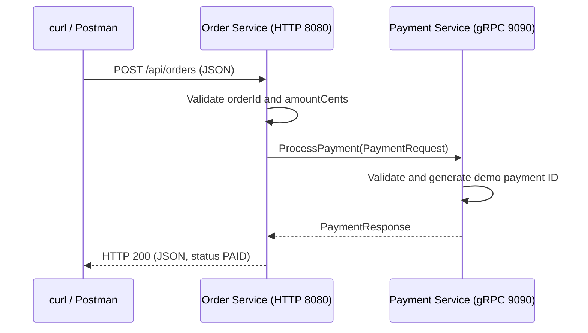

# gRPC Payment Demo — Code Explanation and Presentation Guide

## 1. What this project demonstrates

This is a Java multi-module backend project demonstrating communication between two independently running Spring Boot services using **gRPC**.

A client sends an HTTP order request to **Order Service**. Order Service calls **Payment Service** over gRPC. Payment Service simulates a successful payment and returns a response, which Order Service converts to JSON.

Payments are simulated: no bank is contacted, no money moves, and no order or payment is stored. The `PAID` status represents demo success only. Bakong has been removed.

Suggested introduction:

> “My project demonstrates synchronous service-to-service communication using gRPC. Order Service exposes a REST API, while Payment Service handles a simulated payment through a shared protobuf contract.”

## 2. Architecture and request flow



Ports above are the intended local defaults; the project does not explicitly set the HTTP or gRPC server port. Confirm the bound ports in startup logs.

The two network boundaries use different formats:

| Connection | Protocol / format | Role |
| --- | --- | --- |
| Client → Order Service | HTTP with JSON | Public demo endpoint |
| Order Service → Payment Service | gRPC with protobuf messages | Internal payment call |

The RPC is **unary**: one request produces one response. The client uses a blocking stub, so the HTTP request waits for the payment result. A 15-second deadline bounds the RPC.

## 3. Project structure

```text
untitled-demo/
├── settings.gradle                     Registers modules and build-logic
├── build.gradle                        Applies common Java conventions
├── gradlew / gradlew.bat                Gradle wrapper launchers
├── gradle/wrapper/                      Pins Gradle 9.6.0
├── build-logic/                         Reusable Gradle convention plugins
│   ├── build.gradle                     Declares external plugin dependencies
│   └── src/main/groovy/
│       ├── java-common-conventions.gradle
│       ├── spring-common-conventions.gradle
│       └── spring-boot-common-conventions.gradle
├── share-common/
│   └── common-grpc/
│       ├── build.gradle                 Configures protobuf / gRPC generation
│       └── src/main/proto/payment.proto Shared service contract
├── order-service/
│   ├── build.gradle
│   └── src/
│       ├── main/java/
│       │   ├── kh/edu/istad/OrderApplication.java
│       │   ├── kh/edu/istad/PaymentConfiguration.java
│       │   ├── controller/OrderController.java
│       │   └── service/PaymentClient.java
│       ├── main/resources/application.yaml
│       └── test/java/kh/edu/istad/OrderApplicationTests.java
└── payment-service/
    ├── build.gradle
    └── src/
        ├── main/java/
        │   ├── kh/edu/istad/PaymentApplication.java
        │   └── service/PaymentGrpcService.java
        ├── main/resources/application.yaml
        └── test/java/kh/edu/istad/PaymentApplicationTests.java
```

Despite the parent directory being named `micro-frontend`, this project contains backend services. It has no frontend application, database, gateway, or service discovery implementation.

## 4. Shared contract: payment.proto

File: `share-common/common-grpc/src/main/proto/payment.proto`

```proto
service PaymentService {
  rpc ProcessPayment (PaymentRequest) returns (PaymentResponse);
}

message PaymentRequest {
  string order_id = 1;
  int64 amount_cents = 2;
}

message PaymentResponse {
  string payment_id = 1;
  bool success = 2;
  string message = 3;
}
```

This file defines the method both services agree to use and the fields exchanged over the network.

- `syntax = "proto3"` selects protobuf syntax.
- `package payment` supplies the protobuf service namespace.
- `java_package = "com.example.common.grpc.payment"` controls generated Java imports.
- `java_multiple_files = true` generates separate top-level Java classes for messages.
- Numbers such as `1` and `2` identify fields on the wire. Preserve them when evolving existing fields; do not reuse removed tags.
- `amount_cents` is an integer: `1500` represents 15.00 in a currency with 100 minor units. There is no currency field in this demo.

The build generates classes such as `PaymentRequest`, `PaymentResponse`, and `PaymentServiceGrpc`. Both services depend on the same `:share-common:common-grpc` library. Generated code belongs under `build/`; edit the `.proto` file to change the contract.

Suggested explanation:

> “The proto file is the agreement between services. Gradle generates the Java message classes, client stub, and server base class, so I do not manually implement message serialization or the RPC transport.”

## 5. Order Service: receiving HTTP and calling gRPC

### OrderApplication.java

Starts Spring Boot. Its `scanBasePackages` includes `kh.edu.istad`, `service`, and `controller`, because the controller and service packages are outside the main application's package.

### PaymentConfiguration.java

Defines a Spring `@Bean` for `PaymentServiceBlockingStub`:

```java
return PaymentServiceGrpc.newBlockingStub(channels.createChannel("payment"));
```

`GrpcChannelFactory` creates the channel. The name `payment` selects the corresponding configuration:

```yaml
spring:
  grpc:
    client:
      channel:
        payment:
          target: "${PAYMENT_GRPC_ADDRESS:localhost:9090}"
          ssl:
            enabled: false
```

The environment variable can override the destination. Plaintext is appropriate for this local demo; TLS is not configured.

### PaymentClient.java

Receives the generated blocking stub through constructor injection. Its `process` method:

1. Builds a protobuf `PaymentRequest` from the order ID and integer amount.
2. Adds a 15-second deadline.
3. Calls `processPayment(request)` on the stub.
4. Returns the generated `PaymentResponse`.

```java
return stub.withDeadlineAfter(15, TimeUnit.SECONDS).processPayment(request);
```

Although this looks like an ordinary Java method call, it sends a request to another process over the network.

### OrderController.java

Exposes `POST /api/orders`. Spring converts JSON into the `CreateOrderRequest` record.

The controller rejects a null or blank `orderId`, or an `amountCents` value less than or equal to zero, with HTTP 400 before calling Payment Service.

For valid input, it calls `PaymentClient.process(...)` and builds an `OrderResult` record:

| JSON result field | Source |
| --- | --- |
| `orderId` | Original order request |
| `paymentId` | gRPC payment response |
| `status` | `PAID` if `success` is true, otherwise `PAYMENT_FAILED` |
| `message` | gRPC payment response |

The current Payment Service always returns success for valid input. The `PAYMENT_FAILED` branch supports a future response with `success=false`.

A `StatusRuntimeException` from the gRPC call becomes HTTP 502. This includes unavailable services, deadlines, and other RPC status errors. Exact HTTP error-body details depend on Spring's error configuration; demonstrate the HTTP status rather than assuming a particular error JSON shape.

## 6. Payment Service: implementing the RPC

### PaymentApplication.java

Starts Spring Boot and scans the application and service packages. The gRPC server starter provides server auto-configuration.

### PaymentGrpcService.java

This Spring `@Service` extends the generated server base class:

```java
public class PaymentGrpcService
        extends PaymentServiceGrpc.PaymentServiceImplBase
```

It overrides `processPayment` to implement the contract:

1. Reject a blank order ID or non-positive amount with gRPC `INVALID_ARGUMENT`.
2. Generate a payment ID using `"demo-" + UUID.randomUUID()`.
3. Build a response with `success=true` and the message `Demo payment successful (simulated)`.
4. Send the response with `observer.onNext(...)`.
5. Finish the RPC with `observer.onCompleted()`.

`StreamObserver` is the callback API for delivering the server response. `onError(...)` ends a failed RPC; the method returns immediately afterward.

Validation exists in both services because Payment Service could also be called directly by a different gRPC client.

Repeated requests create new random payment IDs. There is no deduplication or idempotency mechanism.

## 7. Build configuration

The project declares Java 25, Gradle 9.6.0, and Spring Boot 4.1.1 in its checked-in configuration. These are project settings, not a claim that a build has passed in this environment.

`settings.gradle` registers the modules and includes `build-logic` as a separate plugin build.

| Convention plugin | Responsibility |
| --- | --- |
| `java-common-conventions` | Java 25 toolchain, group/version, Maven Central, JUnit platform |
| `spring-common-conventions` | Java conventions, Spring Boot dependency BOM, logging, validation, Spring tests, annotation processors |
| `spring-boot-common-conventions` | Spring conventions plus executable Boot packaging and `bootRun` |

`build-logic/build.gradle` supplies the Spring Boot, dependency-management, and protobuf Gradle plugins to these convention scripts.

`common-grpc/build.gradle` applies protobuf generation and obtains the protobuf and gRPC generator versions from the imported Spring Boot BOM. It exports `grpc-protobuf` and `grpc-stub` with `api`, since generated public APIs expose those types.

Order Service adds the Web MVC starter and gRPC client starter. Payment Service adds the gRPC server starter. Both depend on the shared generated contract.

Lombok and MapStruct are configured in the shared conventions, but the current application code does not use them. Similarly, validation dependencies are present, while the controller currently performs manual validation.

## 8. Run the live demo

Run commands from the project root. Use a local terminal with JDK 25, access to required dependency repositories on the first build, and free ports 8080 and 9090.

### Step 1: Build

```sh
java -version
./gradlew clean build
```

This should generate the protobuf classes, compile the modules, run the existing tests, and package the application jars. Resolve any build errors before presenting.

### Step 2: Start Payment Service in terminal A

```sh
./gradlew :payment-service:bootRun
```

Wait for successful startup and check the gRPC listening port in the logs.

### Step 3: Start Order Service in terminal B

```sh
./gradlew :order-service:bootRun
```

Wait for the HTTP server to start, normally on port 8080.

If Payment Service runs on a different host or port, set the destination when starting Order Service:

```sh
PAYMENT_GRPC_ADDRESS=localhost:9090 ./gradlew :order-service:bootRun
```

Changing this client address does not change the Payment Service's listening port.

### Step 4: Demonstrate a successful request in terminal C

```sh
curl -i -X POST http://localhost:8080/api/orders \
  -H 'Content-Type: application/json' \
  -d '{"orderId":"demo-order-1","amountCents":1500}'
```

Expected HTTP status: **200**. Illustrative JSON:

```json
{
  "orderId": "demo-order-1",
  "paymentId": "demo-<generated-uuid>",
  "status": "PAID",
  "message": "Demo payment successful (simulated)"
}
```

The payment ID changes for each successful call.

Say:

> “This request entered Order Service as JSON. Order Service validated it and sent a protobuf request to Payment Service through gRPC. Payment Service returned a simulated result, and Order Service converted that result back to JSON.”

### Step 5: Demonstrate invalid input

```sh
curl -i -X POST http://localhost:8080/api/orders \
  -H 'Content-Type: application/json' \
  -d '{"orderId":"","amountCents":0}'
```

Expected HTTP status: **400**. The controller rejects this request before sending a payment RPC.

### Step 6: Demonstrate a service outage

Stop Payment Service with Ctrl+C in terminal A, leaving Order Service running. Repeat the valid request from step 4.

Expected HTTP status: **502** when the gRPC call fails. The call has a 15-second deadline; an unavailable connection may fail sooner.

Say:

> “This failure shows that payment processing is a network call to an independent service. Order Service translates the gRPC error into an HTTP error for its client.”

Restart Payment Service afterward and repeat the successful request to finish the demo.

## 9. Suggested presentation order

1. Introduce the two services and the simulated payment scenario.
2. Show the architecture diagram and explain REST versus gRPC boundaries.
3. Open `payment.proto`: explain the RPC, request, response, and field numbers.
4. Open `PaymentGrpcService.java`: show the generated base class, validation, and response callbacks.
5. Open `PaymentConfiguration.java` and `PaymentClient.java`: show the named channel, blocking stub, and deadline.
6. Open `OrderController.java`: show JSON input, validation, the payment call, and JSON output.
7. Show `build-logic` briefly to explain how shared build rules avoid repetition.
8. Run the success, invalid-input, and unavailable-service demonstrations.
9. Explain the tests and current limitations accurately.

## 10. Questions you may receive

**Why use a shared module?**

Both services compile against the same contract and generated types. This reduces manual duplication. They still run as separate applications.

**Why use gRPC here?**

It demonstrates a typed service API defined in protobuf, generated client/server code, and binary messages for internal communication. This project does not include benchmarks comparing it with REST.

**Why keep a REST endpoint?**

It gives curl or Postman a convenient JSON entry point while the internal service call demonstrates gRPC.

**Why integer cents?**

Integer minor units avoid floating-point rounding in the amount representation. The demo has no currency selection or currency-specific rules.

**Is the stub synchronous?**

Yes. The blocking stub waits for the payment response or an RPC error, with a 15-second deadline.

**Does the application create a real order?**

It accepts an order-shaped request and returns a result. There is no persistence, order repository, or stored order lifecycle.

**Does a successful test prove the network flow works?**

No. The current tests check Spring context startup. A live request with both services running is needed to demonstrate the full network flow.

## 11. Review findings and verification limits

The source separates HTTP handling, the gRPC client, the server implementation, and the shared contract. Both service boundaries validate essential input, and the client has a deadline.

The current implementation has these limits:

- Payments always succeed for valid input and are explicitly simulated.
- There is no database, persistence, authentication, TLS configuration, retry policy, or idempotency handling.
- All gRPC status exceptions in the controller become HTTP 502; they are not mapped individually.
- The two existing tests only load Spring contexts. The payment context test disables its gRPC server, and the order context test does not send an RPC. There are no current assertions for payment behavior or end-to-end communication.
- Default server ports are assumed for the local run instructions; verify the actual startup logs.

Build verification in this editing environment was blocked before compilation: the wrapper could not write its lock file in the read-only Gradle user directory. Running the installed Gradle with a writable temporary user directory then failed because the sandbox could not provide a usable wildcard IP. No successful build, test run, or live HTTP/gRPC result is claimed here. The responses above are expectations derived from the source code.

Before presenting, run `./gradlew clean build` and all three live demo scenarios in your normal terminal.
